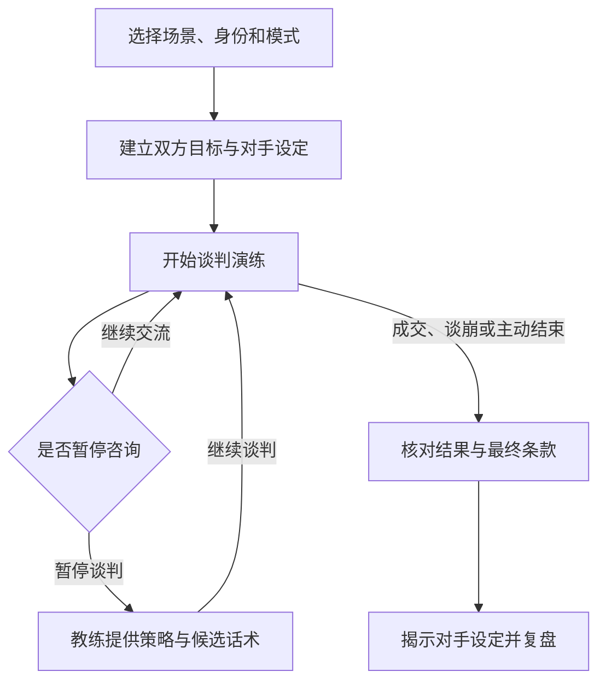

# 奇葩谈判模拟器

**选择场景与身份 → 和 AI 对手进行谈判演练 → 根据实际对话复盘，找到下一次更好的说法。**

一个在 Codex 对话中使用的 Agent Skill。你扮演谈判一方，AI 扮演对手；谈判结束后，AI 再切换为教练，分析报价、让步、关键转折和未谈妥的条件。

适合在正式沟通前练习提问、交换条件和收尾。仓库提供技能规则与调用配置，运行依赖支持 Skill 的 AI 工具，无需为本项目安装 Python 或 Node.js。

## 📊 工作流程



## ✨ 功能特性

| 能力 | 使用时会发生什么 |
| --- | --- |
| 🎲 盲盒模式 | AI 生成对手的诉求、底线、替代方案和让步方式，复盘前不主动揭示 |
| 🎛️ 自定义模式 | 按你给出的双方身份、背景、对手诉求与性格开展练习 |
| 💬 对手角色扮演 | 谈判中输出对手能说出口的话，不替你发言 |
| ⏸️ 暂停咨询 | 临时切换为教练，讨论策略后继续同一场谈判 |
| 🤝 成交核对 | 区分试探、部分条款一致和双方完整接受，避免把“可以考虑”当成成交 |
| 📝 对话复盘 | 结合真实出现的对话分析表现，给出下一步动作与改进话术 |

上述行为由 [SKILL.md](./SKILL.md) 约定，实际执行效果取决于宿主工具和所用模型。

## 🧱 项目组成

| 部分 | 作用 |
| --- | --- |
| Markdown 技能规则 | 在 `SKILL.md` 中定义开始条件、对手行为、暂停咨询和复盘格式 |
| YAML 调用配置 | 在 `agents/openai.yaml` 中定义显示名称、默认提示词与自动调用配置 |
| 对话执行 | 由支持 Skill 的 AI 工具读取规则并完成角色扮演 |

仓库没有独立模型服务或 API Key 配置文件，模型选择与使用额度由宿主工具管理。

## 🚀 快速开始

### 1. 安装到 Codex

在支持内置安装技能的 Codex 对话框中输入下面这段话。

```text
使用 $skill-installer 安装 https://github.com/RoourChen/simulating-quirky-negotiations 。技能文件位于仓库根目录。
```

安装完成后，在后续对话中调用技能。如果没有识别到，先确认安装成功，再新建对话或重启 Codex。手动安装时，需要把包含 `SKILL.md` 和 `agents/` 的整个目录放入当前工具识别的技能目录，不能只复制 README。安装机制可参考 [官方技能说明](https://developers.openai.com/codex/skills)。

### 2. 开始第一场练习

以下是一个练习输入示例，场景与金额均为假设。

```text
使用 $simulating-quirky-negotiations 开始一场盲盒谈判。
我是租客，你是房东。我的目标是在续租一年时，把月租从 3500 元谈到 3200 元。
难度选标准。请扮演房东，不要提前透露你的底线。
```

信息足够时进入谈判；缺少关键设定时，技能会先补问。默认采用盲盒模式和标准难度，也可选择简单、困难或自定义模式。

### 3. 暂停、继续与结束

| 输入 | 作用 |
| --- | --- |
| `暂停谈判` | 暂停角色扮演，进入教练咨询 |
| `我可以怎样回应刚才的报价？` | 在暂停期间请求策略建议 |
| `继续谈判` | 恢复原对手角色和谈判进度 |
| `结束谈判` | 主动结束当前练习并复盘 |

普通的谈判知识问答、单独索要话术或分析过去的谈判，不会自动开始角色扮演。

## ⚙️ 场景配置

| 信息 | 怎么填写 |
| --- | --- |
| 模式 | 盲盒或自定义 |
| 场景与双方身份 | 说明在谈什么、你是谁、对手是谁 |
| 公开目标 | 说明你希望达成的结果 |
| 难度 | 简单、标准或困难 |
| 私密目标与替代方案 | 可选，说明谈不成时还有什么选择；规则要求对手角色不能利用这部分私密信息 |
| 自定义对手设定 | 自定义模式下补充对手诉求、底线、性格和背景 |

技能中的 BATNA 指“这场谈判谈不成时，你最好的替代选择”。它用于判断一个报价是否值得接受。

### 自定义模式示例

下面是虚构的项目合作练习。自定义模式适合你希望反复练习某一种对手的情况。

```text
使用 $simulating-quirky-negotiations 开始自定义谈判。
我是一名自由设计师，你是一家店铺的负责人。
我们要谈官网设计的费用、交付时间和修改次数。
我的公开目标是 8000 元、两周交付、包含两轮修改。
对手预算上限为 6500 元，希望十天上线，性格直接，最在意时间。
难度选标准。请按这个设定与我谈，不要替我回答。
```

自定义模式中的对手设定由你提供，因此你已经知道这些信息。想练习通过提问发现未知诉求时，选择盲盒模式。

## 📝 复盘会得到什么

复盘包含结果、已确认和未确认的条款、对手真实设定、最多三个关键转折，以及表现分析和重谈方案。准备、提问、锚定、价值交换、情绪管理与收尾六个维度会分别给出 1 至 10 分及对话依据。

这些分数用于定位练习中的具体问题，不代表真实谈判成功率。没有出现过的行为，应当标明缺少证据。

| 结果 | 判定方式 |
| --- | --- |
| 达成协议 | 双方明确接受同一套完整的关键条款 |
| 部分协议 | 只确认了一部分议题，仍有条件未谈妥 |
| 谈判破裂 | 明确拒绝继续，或确认没有双方可接受的方案 |
| 主动终止 | 尚未成交时，由你输入“结束谈判”停止练习 |

## 📁 目录结构

```text
simulating-quirky-negotiations/
├── README.md          # 项目介绍与使用指南
├── SKILL.md           # 触发条件、谈判流程与复盘规则
└── agents/
    └── openai.yaml    # 显示名称、默认提示词与调用配置
```

## 🧪 使用检查

仓库当前没有自动化测试脚本。安装后，可以用同一场虚构谈判检查以下行为。

- 开始后 AI 是否保持对手身份，没有代写你的回答。
- 暂停时是否提供策略建议，继续后是否保留已谈条件。
- 输入“结束谈判”后，是否区分主动终止与谈判破裂，并引用实际对话复盘。

## 📌 当前边界

隐藏底线与双方信息隔离通过提示规则约束，同一模型扮演多个角色不构成技术上的信息隔离。练习时适合使用虚构或脱敏资料。仓库不包含独立网页、语音系统或跨会话存档服务。

模拟中的对手反应不能预测真实对手的决定。涉及现实政策或专业判断时，应以实际资料为准。

## 📚 项目文件

- [完整技能规则](./SKILL.md)
- [Codex 调用配置](./agents/openai.yaml)

当前仓库未提供 `LICENSE` 文件。
